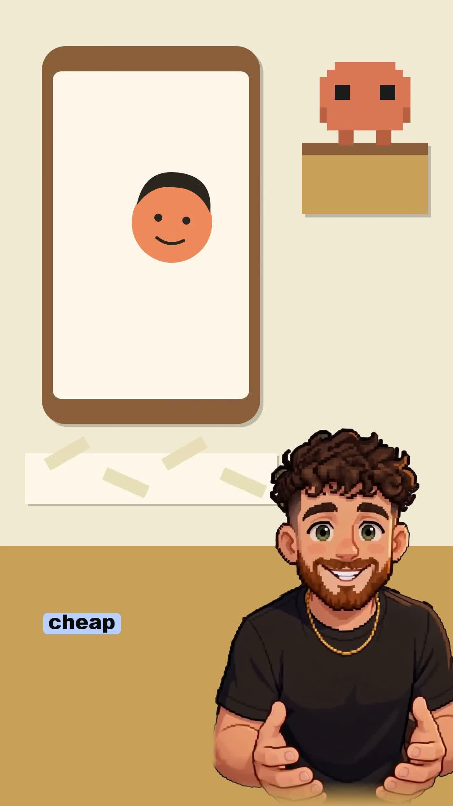

# Claude Creator Skills: 59 free Claude skills for short-form video

Free Claude skills for making animations, editing reels, writing hooks, captions and plans, and getting found on Google. Download everything in one go (**ULTRA**), or just the pack you need. They work on a fresh Claude install, everything runs on your own computer, and nothing gets posted or paid for without you.

Every pack is built with **[Vera](https://github.com/WCRWCR12/vera)**, a free AI chief of staff for Claude. More info: **[systemgc.com.au](https://www.systemgc.com.au)** · New free skills every week: **[@will.ai.m_system](https://www.instagram.com/will.ai.m_system/)**

---

## Commented FORMAT? Start here

**[Read the FORMAT guide](FORMAT-GUIDE.md)**: how to make the animations from the reel yourself, step by step, in about 15 minutes.

## Download

<!-- PACKS:START -->
| Pack | Skills | Download | What you get |
|---|---|---|---|
| **ULTRA** (everything) | 59 | **[Download ULTRA (955 KB)](https://github.com/WCRWCR12/claude-creator-skills/raw/main/downloads/ULTRA-all-skills.zip)** | every pack below in one folder |
| **Reel Pack v2** (`PACK`) | 15 + studio kit | **[Download](https://github.com/WCRWCR12/claude-creator-skills/raw/main/downloads/reel-pack-v2.zip)** (10.9 MB) | A whole reel studio for Claude Code, not just skills: make coded 9:16 videos in the myth-explainer style (a 3D man in a blue grid studio, one-second shots, 1-3 word captions) and lit 3D hero shots. Includes the rigged character, the studio kit, a crew of agents, check tools and a worked example. Unzip, run the installer, open Claude Code in the folder. [What's inside](reel-pack/README.md) |
| **Animation Styles** (`FORMAT`) | 8 | [Download](https://github.com/WCRWCR12/claude-creator-skills/raw/main/downloads/01-animation-styles.zip) (70 KB) | Make the animations from the reels: 100+ coded animation styles (paper cut-out, clay, pixel art, chalk, neon and more), your logo animated, motion-graphics reels with a self-critique loop. |
| **Video Editing** (`CUT`) | 8 | [Download](https://github.com/WCRWCR12/claude-creator-skills/raw/main/downloads/02-video-editing.zip) (41 KB) | Raw clip to finished reel: tight cuts, word-by-word captions, voiceover direction, local text-to-speech, sounds, and a video editor Claude builds for you. |
| **Hooks and Scripts** (`HOOK`) | 8 | [Download](https://github.com/WCRWCR12/claude-creator-skills/raw/main/downloads/03-hooks-and-scripts.zip) (69 KB) | Hooks written seven ways and tested, 100 hook formulas, and scripts for Reels and TikTok that hold attention to the end. |
| **Reel Formats and Research** (`WATCH`) | 8 | [Download](https://github.com/WCRWCR12/claude-creator-skills/raw/main/downloads/04-reel-formats-and-research.zip) (537 KB) | Proven reel formats beat by beat, a house reel style, film-director shot plans, and tools to study any video or rival cheaply. |
| **Captions and Growth** (`CAPTION`) | 8 | [Download](https://github.com/WCRWCR12/claude-creator-skills/raw/main/downloads/05-captions-and-growth.zip) (109 KB) | Captions Instagram and TikTok search can find, hashtags, profile fixes, clipping long videos, and a daily engagement routine. |
| **Plan and Brand** (`PLAN`) | 10 | [Download](https://github.com/WCRWCR12/claude-creator-skills/raw/main/downloads/06-plan-and-brand.zip) (127 KB) | A month of posts in one sitting, content pillars, your brand voice, your audience's own words, trends worth jumping on, carousels and image prompts. |
| **SEO and Getting Clients** (`RANK`) | 9 | [Download](https://github.com/WCRWCR12/claude-creator-skills/raw/main/downloads/07-seo-and-clients.zip) (26 KB) | Rank on Google and in AI search, get listed, turn a viral video into a page, and run outreach and ads that bring in clients. |
<!-- PACKS:END -->

## How to install (any pack)

1. Download a zip above and unzip it.
2. Open the Claude desktop app and go to the **Code** tab.
3. Drag the unzipped folder into the chat and say: **"install these skills"**.

Claude follows `INSTALL.md`: it copies each skill into your skills folder, checks whether you have the free tools some skills need (ffmpeg, Python, Node), and shows you one example prompt per skill. Start a new chat afterwards so the skills load.

**The Reel Pack installs differently.** It is a full project folder, not loose skills: unzip it, run its installer (`install.ps1` on Windows, `install.sh` on Mac and Linux), then open Claude Code in that folder. Steps and a first prompt are in [reel-pack/README.md](reel-pack/README.md).

## Came from a reel? Find your pack

| You commented | Get this |
|---|---|
| **FORMAT** | [The FORMAT guide](FORMAT-GUIDE.md) + the Animation Styles pack (or ULTRA for everything) |
| **CUT** | Video Editing pack |
| **HOOK** | Hooks and Scripts pack |
| **WATCH** / **GAP** | Reel Formats and Research pack |
| **CAPTION** | Captions and Growth pack |
| **PLAN** | Plan and Brand pack |
| **RANK** | SEO and Getting Clients pack |
| **SKILLS** / **GUIDE** | ULTRA (everything) |
| **PACK** | [Reel Pack v2](reel-pack/README.md): the whole reel studio (myth-explainer videos with a 3D man in a blue grid studio, plus 3D hero shots) |

## Every skill

<!-- SKILLS:START -->
### Animation Styles (`FORMAT`)

- **[animation-styles](skills/animation-styles/SKILL.md)**: A library of 123 named, coded animation and motion-graphic styles (paper cut-out, brick toy, pixel art, chalkboard, neon, watercolour, woodcut,…
- **[animation-ground-truth](skills/animation-ground-truth/SKILL.md)**: A house animation style for motion graphics and faceless reels.
- **[motion-graphics-render-loop](skills/motion-graphics-render-loop/SKILL.md)**: Make premium coded motion-graphics reels (spring physics, real UI assets, cuts locked to a beat) with Remotion, plus a self-critique loop that hunts…
- **[logo-animation](skills/logo-animation/SKILL.md)**: Animates a logo in code, no After Effects: it draws the logo in lines, explodes it into parts, and snaps it back together in about four seconds,…
- **[numbered-technique-showcase-reel](skills/numbered-technique-showcase-reel/SKILL.md)**: A reel format for demonstrating a set of related skills or techniques.
- **[one-to-one-style](skills/one-to-one-style/SKILL.md)**: Copy a reference reel's animation style at a chosen fidelity (exact re-shoot, style match, or pattern match).
- **[pixel-narrator](skills/pixel-narrator/SKILL.md)**: Build a coded pixel-art narrator character in Remotion, a Stardew-style game portrait that pops up in the corner of a reel, lip-syncs to the…
- **[video-contact-sheet](skills/video-contact-sheet/SKILL.md)**: Cut the token cost of reading a video.

### Video Editing (`CUT`)

- **[reel-cutter](skills/reel-cutter/SKILL.md)**: Cuts a raw talking-to-camera video into a tight reel.
- **[caption-sync](skills/caption-sync/SKILL.md)**: Burns word-by-word captions into a video.
- **[instagram-edit](skills/instagram-edit/SKILL.md)**: Write and edit talking-head Instagram Reels and TikToks.
- **[anti-slop-ai-video-editing](skills/anti-slop-ai-video-editing/SKILL.md)**: Five rules for editing short-form videos with Claude without the output looking like AI slop (captions, imagery, image placement, cuts, motion…
- **[live-editable-video-editor](skills/live-editable-video-editor/SKILL.md)**: Build a lightweight video editor with Claude so a creator can tweak captions, stickers and audio live instead of describing changes in chat and…
- **[vo-delivery-direction](skills/vo-delivery-direction/SKILL.md)**: Direct a voiceover so it sounds like a person talking, not an AI reading.
- **[voice-studio-local-tts](skills/voice-studio-local-tts/SKILL.md)**: Run open-source text-to-speech or voice cloning locally for faceless reel narration at no per-generation cost.
- **[trending-sounds](skills/trending-sounds/SKILL.md)**: Find the sounds Instagram Reels are using right now (trending audio, viral original audio, TikTok crossovers, evergreen meme sounds, SFX and…

### Hooks and Scripts (`HOOK`)

- **[hook-writer](skills/hook-writer/SKILL.md)**: the opening that earns attention — for any social content: a caption's first line, a video's first three seconds, a carousel cover slide, a thread…
- **[viral-hooks](skills/viral-hooks/SKILL.md)**: Generate 3 scroll-stopping hook variants for short-form video scripts (Reels, TikTok, YouTube, LinkedIn, X).
- **[hook-virality-check](skills/hook-virality-check/SKILL.md)**: Compare several hook variants of one reel before posting, pick the winner, and find the drop-off point to re-edit.
- **[reels-script](skills/reels-script/SKILL.md)**: a native, sound-off-first short-video script optimized for Instagram's discovery engine, built around a 3-second hook, watch-through, and sends (DM…
- **[tiktok-script](skills/tiktok-script/SKILL.md)**: a native, sound-aware short-video script optimized for TikTok's discovery engine (the FYP), built around a brutal 1-second hook, watch-time, and…
- **[scriptwriting-methodology](skills/scriptwriting-methodology/SKILL.md)**: Direct response copywriting frameworks for video scripts.
- **[content-principles](skills/content-principles/SKILL.md)**: The psychology behind short-form content that holds attention.
- **[illusion-of-novelty](skills/illusion-of-novelty/SKILL.md)**: A four-step storytelling framework (new reveal, contrast framing, urgency, bullseye proof) for making any topic feel fresh and addictive in…

### Reel Formats and Research (`WATCH`)

- **[reel-formats-library](skills/reel-formats-library/SKILL.md)**: A library of proven short-form reel and ad formats, broken down beat by beat with timings, pacing, caption style and how to remake each for a brand…
- **[reel-style](skills/reel-style/SKILL.md)**: A complete house style for face-to-camera tech/tool explainer reels - a title-card hook, a face-to-camera base layer, full-frame…
- **[cinematic-director](skills/cinematic-director/SKILL.md)**: Acts as a director and previs supervisor for film, video, and AI filmmaking.
- **[hook-flip-reel-scout](skills/hook-flip-reel-scout/SKILL.md)**: Find and verify reference short videos for the "hook then hard flip to product" ad format (a raw fail, funny or odd moment of 2-6 s, then slick…
- **[real-screenshots-value-led](skills/real-screenshots-value-led/SKILL.md)**: A reel format built on genuine UI screenshots and real tool, app or data visuals to deliver value-led content.
- **[viral-reverse-engineering](skills/viral-reverse-engineering/SKILL.md)**: yours or someone else's — and extract the repeatable mechanism to apply to your own content.
- **[bot-series-workflow](skills/bot-series-workflow/SKILL.md)**: Split a reel and caption pipeline into a series of single-purpose agents (research, pattern, script, edit, critic, caption), each with one input,…
- **[competitor-analysis](skills/competitor-analysis/SKILL.md)**: Competitor analysis for social media — public-data competitive reconnaissance to find the gap a brand can own.

### Captions and Growth (`CAPTION`)

- **[caption-writer](skills/caption-writer/SKILL.md)**: the words that accompany a post on Instagram, LinkedIn, TikTok, Facebook, X/Twitter, Threads, Pinterest, YouTube, or Bluesky.
- **[social-seo](skills/social-seo/SKILL.md)**: the social-SEO / keyword-discovery skill.
- **[captions-and-clipping](skills/captions-and-clipping/SKILL.md)**: The long-form-to-Shorts + sound-off captions mini-skill (Opus Clip / CapCut / Submagic).
- **[hashtag-strategy](skills/hashtag-strategy/SKILL.md)**: the modern (2026) approach, not the outdated "30 hashtags to go viral" playbook.
- **[instagram-growth](skills/instagram-growth/SKILL.md)**: the Instagram-specific growth strategy that diagnoses where growth is stuck (reach, follow-conversion, retention, or shares) and orchestrates the…
- **[tiktok-growth](skills/tiktok-growth/SKILL.md)**: the TikTok-specific growth strategy that diagnoses where growth is stuck and orchestrates the other skills to fix it.
- **[profile-optimization](skills/profile-optimization/SKILL.md)**: bio, handle, name/headline field, profile picture, banner/header, link-in-bio, CTA, pinned posts, and highlights.
- **[engagement-routine](skills/engagement-routine/SKILL.md)**: the operating system that turns the engagement craft into a daily/weekly habit.

### Plan and Brand (`PLAN`)

- **[batch-content-plan](skills/batch-content-plan/SKILL.md)**: a week or a month — in one session: strategically balanced, on-brand, mapped to a calendar, and ready to schedule.
- **[content-calendar](skills/content-calendar/SKILL.md)**: a sustainable, repeatable posting rhythm and recurring structure (which pillars/formats post on which days, on which platforms), derived from…
- **[content-pillars](skills/content-pillars/SKILL.md)**: the 3–5 recurring themes it posts about — the strategic backbone between the brand profile and the content calendar.
- **[social-strategy](skills/social-strategy/SKILL.md)**: which channels to focus on (and which to ignore), what to achieve, the angle to win, and a realistic operating cadence.
- **[brand-profile](skills/brand-profile/SKILL.md)**: Use FIRST, before any other social media skill, to load or create the brand profile — the durable record of who a business is, who it serves, how it…
- **[voice-builder](skills/voice-builder/SKILL.md)**: Use to build a reusable voice guide (voice.md) by analyzing a person's or brand's ACTUAL writing samples — so every other social skill can write in…
- **[audience-research](skills/audience-research/SKILL.md)**: sharp enough that every content skill resonates with them specifically.
- **[trend-jacking](skills/trend-jacking/SKILL.md)**: a trending sound, format, meme, hashtag, news moment, or cultural conversation — to earn reach by attaching the brand to something already getting…
- **[image-prompt](skills/image-prompt/SKILL.md)**: Use as the foundation and router for any image a post needs — turn a social need into a clear image brief, describe it with model-agnostic prompt…
- **[auto-carousel](skills/auto-carousel/SKILL.md)**: A pipeline for producing on-brand Instagram carousels where you only approve topics and final slides.

### SEO and Getting Clients (`RANK`)

- **[rank-fast-seo-article](skills/rank-fast-seo-article/SKILL.md)**: Write a search-targeted article by scraping what already ranks on page 1, adding the founder's own point of view, and checking the ranking.
- **[parasite-seo](skills/parasite-seo/SKILL.md)**: Rank for buyer-intent searches by publishing useful pages on sites Google and AI assistants already trust (Zenodo, LinkedIn, Gamma, Reddit, listicle…
- **[local-citations-listings](skills/local-citations-listings/SKILL.md)**: Build or audit free local business citations, listings and entity profiles (Google Business Profile, Bing, Apple, directories, trade marketplaces,…
- **[founder-about-page-seo](skills/founder-about-page-seo/SKILL.md)**: Audit or write a small business's About page, statistics/original-research page and footer links to improve search and AI-answer visibility.
- **[meta-muse-content-research](skills/meta-muse-content-research/SKILL.md)**: Plan Instagram content using trend, niche-creator and own-account insight.
- **[viral-reel-to-page](skills/viral-reel-to-page/SKILL.md)**: Turn a viral "look what AI does for my business" social reel into an indexable landing page that catches the Google and AI-assistant searches the…
- **[cold-email-infrastructure](skills/cold-email-infrastructure/SKILL.md)**: Plan, size and run a compliant cold email system for a small business: sending domains and inboxes, DNS (SPF/DKIM/DMARC), warmup, deliverability…
- **[google-ads-offer-led-playbook](skills/google-ads-offer-led-playbook/SKILL.md)**: Offer-led Google Ads playbook for local and B2B small businesses.
- **[website-revamp-outreach](skills/website-revamp-outreach/SKILL.md)**: Find local businesses with weak websites, build a template-based mock revamp, and draft a compliant enquiry message for you to review and send…
<!-- SKILLS:END -->

## What you need

Nothing to start. Some skills use free tools: **ffmpeg**, **Python** (with faster-whisper) and, for animation, **Node** with **Remotion**. When you install, Claude checks what you have and tells you exactly what's missing.

## Licences

Most skills are our own. Some are MIT-licensed skills by other authors, with their licence notices kept. See [LICENSES.md](LICENSES.md). The Reel Pack has its own `LICENSE` and `THIRD-PARTY-NOTICES.md` (its 3D character and motion clips are CC0 by Quaternius).

## For maintainers

Skills live in `skills/`. Packs are defined in `packs.json`. Run `python tools/build.py` to check every skill, scan for private details, rebuild the zips in `downloads/` and refresh the tables in this README. The Reel Pack lives in `reel-pack/` as a whole folder and is listed under `bundles` in `packs.json`; the build scans it the same way and zips it to `downloads/reel-pack-v2.zip`.
