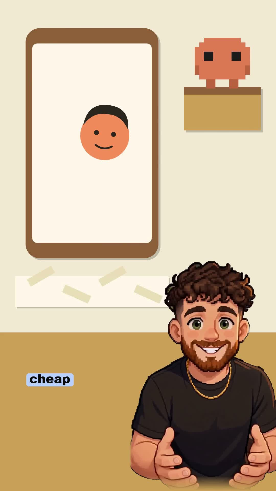

# Creator Pack: 20 free Claude skills for short-form video

**This is one of the free skill packs Will is giving away.** Every pack is built with **[Vera](https://github.com/WCRWCR12/vera)**, a free AI chief of staff for Claude: a personal assistant, a virtual office of AI agents you can watch work, and a growing library of skills. **Vera Social**, the full social media editor where the storyboard is the editor, is being released soon.

- More info: **[systemgc.com.au](https://www.systemgc.com.au)**
- New free skills every week: follow **[@will.ai.m_system](https://www.instagram.com/will.ai.m_system/)** on Instagram

---

One free folder. Twenty Claude skills for editing short-form video: captions, cuts, motion graphics, hooks, scripts, styles and QC. They work on a fresh Claude install. Everything runs on your own computer; nothing gets posted or paid for without you.

## How to install

1. Open the Claude desktop app and go to the **Code** tab.
2. On this page, tap the green **Code** button, then **Download ZIP**, and unzip it. Drag the whole folder into the chat.
3. Say: **"install these skills"**.

Claude follows `INSTALL.md`: it copies each skill into your skills folder, checks whether you have the free tools some skills need (ffmpeg, Python, Node), and shows you one example prompt per skill.

## Came from a reel? Find your pack

You commented a word on a reel and got this link. Here is what each word gets you. Install the whole folder (below) and they are all there.

| You commented | You get | What it does |
|---|---|---|
| **CAPTION** | caption-writer, social-seo, captions-and-clipping | Captions Instagram search can find |
| **HOOK** | hook-writer, viral-hooks, hook-virality-check | Your hook written seven ways, and which one wins |
| **FORMAT** | reel-formats-library, logo-animation, motion-graphics-render-loop | Reel formats that work, plus your logo animated in code (draws in lines, explodes, snaps back) |
| **RANK** | rank-fast-seo-article | One page built to rank on Google |
| **PLAN** | batch-content-plan | A whole month of posts planned in one sitting |
| **GAP** | competitor-analysis | Studies your rivals' public pages and finds the gap you can own |
| **CUT** / **WATCH** | the editing and research skills below | Tight cuts and cheap video reading |

## All 20 skills (+ 1 bonus)

**Editing**
- **reel-cutter**: turns a raw talking-to-camera clip into a tight reel. Cuts pauses, ums, stutters and retakes without clipping a word, then listens to the result to check it.
- **caption-sync**: burns word-by-word captions with a highlight box on the live word, then tests the finished video so every caption lands within 50 ms.
- **instagram-edit**: the full talking-head pipeline: script writing, tight cuts, punch-in zooms, captions and coded motion graphics (XP pops, counters, callouts, keyword slams), with a house-style rulebook that learns from your notes.
- **anti-slop-ai-video-editing**: five rules that stop AI edits looking like AI slop (captions, imagery, placement, cuts, motion graphics).

**Motion graphics and style**
- **logo-animation** (bonus): give Claude your logo and it draws it in lines, explodes it into parts and snaps it back together, four seconds, in code. Ask for any colour.
- **motion-graphics-render-loop**: makes coded motion-graphics reels in Remotion (spring physics, beat-locked cuts) with a self-critique loop that hunts dead frames.
- **animation-ground-truth**: a complete spec for the "breakout card" animation style, plus a split-screen presenter style and an images-first animation workflow.
- **reel-style**: a complete house style for face-to-camera tool-explainer reels: hook card, B-roll rules, captions, script skeleton, shot plan and QA checklist.
- **reel-formats-library**: eight proven reel and ad formats broken down beat by beat, with how to remake each one without copying.
- **cinematic-director**: directs AI-generated or filmed video like a film director: shot plans, lighting, blocking, director styles and prompts for video models.

**Hooks and scripts**
- **hook-writer**: writes hooks for captions, video openings, carousel covers, titles and subject lines, scored and true to the content.
- **caption-writer**: writes platform-native post captions with one goal and one call to action.
- **hook-virality-check**: compares several hook versions of the same reel, picks the winner and finds the drop-off point to re-edit.

**Captions, SEO and planning**
- **social-seo**: makes posts findable in Instagram, TikTok and YouTube search with keywords in the caption, on screen and spoken.
- **captions-and-clipping**: turns long videos into short clips with captions that read well on mute.
- **viral-hooks**: three hook versions from a library of 100 hook formulas.
- **rank-fast-seo-article**: writes one article built to rank for one keyword, with a real opinion in it.
- **batch-content-plan**: plans a month of posts in one go, never day by day.
- **competitor-analysis**: reads rivals' public pages, what they post and what gets engagement, and finds the gap.

**Research and QC**
- **video-contact-sheet**: reads any video cheaply (one tiled image plus a transcript instead of dozens of frames). Use it to study references and to QC your own renders.
- **hook-flip-reel-scout**: finds and verifies reference reels for the "raw moment, then hard flip to product" ad format.

## What you need

Nothing to start. Some skills use free tools: **ffmpeg**, **Python** (with faster-whisper) and, for motion graphics, **Node** with **Remotion**. When you install, Claude checks what you have and tells you exactly what's missing.

## Licences

`hook-writer`, `caption-writer`, `social-seo`, `batch-content-plan`, `viral-hooks` and `cinematic-director` are MIT-licensed. Their licence notices are kept: the `license: MIT` line in each `SKILL.md`, and the `LICENSE` file in `viral-hooks` and `cinematic-director`.
